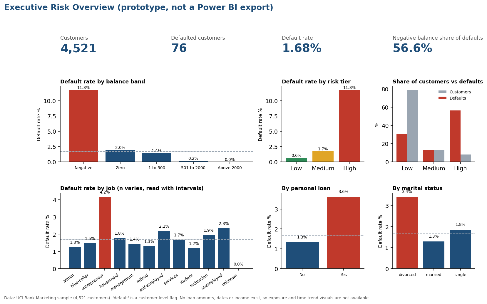

# Credit Risk Analytics & Default Risk Assessment

An end-to-end data analytics project exploring customer default patterns, risk segmentation, statistical associations, and baseline predictive modeling using Python, SQL, Excel, and a Power BI dashboard design.

The project demonstrates how customer-level data can be transformed into actionable risk insights through data cleaning, statistical analysis, risk tiering, model evaluation, and business-focused reporting.

## 1. Business Problem

How can financial institutions identify customer segments associated with higher default rates, establish transparent risk indicators, and prioritize further review without unnecessarily flagging low-risk customers?

## 2. Project Objectives

- Assess the prevalence and distribution of the observed default indicator.
- Identify customer characteristics associated with higher default rates.
- Distinguish segments with high default rates from those contributing the largest number of defaults.
- Develop a transparent, rule-based risk segmentation framework.
- Evaluate baseline classification models using repeated stratified cross-validation.
- Reconcile analytical outputs across Python, SQL, and Excel.
- Translate findings into business recommendations and a dashboard design.

## 3. Dataset & Source

**Source:** UCI Machine Learning Repository — Bank Marketing dataset.

**Reference:** Moro, S., Cortez, P., & Rita, P. (2014). *A data-driven approach to predict the success of bank telemarketing.* Decision Support Systems.

The analysis uses `bank.csv`, a semicolon-separated dataset containing 4,521 customer records from a Portuguese bank's telemarketing campaign.

**Important data context:** This dataset is not a loan portfolio. Its `default` field is a customer-level indicator whose precise definition is not documented in the supplied data. It contains no loan-level exposure, income, interest rates, repayment schedules, payment history, or dates suitable for portfolio trend analysis.

Consequently, the analysis focuses on observed customer-level default patterns rather than loan portfolio loss measurement. The results are specific to this sample and should not be generalized to Bangladeshi banks.

Check the [UCI dataset documentation](https://archive.ics.uci.edu/dataset/222/bank+marketing) and applicable licence terms before redistributing the original data.

## 4. Technology Stack

| Tool | Application |
|---|---|
| Python | Data cleaning, exploratory analysis, statistical testing, modeling, and visualization |
| pandas, SciPy, scikit-learn, statsmodels | Data processing, statistical inference, and model evaluation |
| SQLite | Data querying and validation |
| Microsoft Excel | Analytical workbook, formula-driven calculations, risk summaries, and reporting |
| Power BI | Dashboard specification, layout prototype, and planned interactive reporting |
| Matplotlib | Charts and visual analysis |

The Excel workbook was generated programmatically and contains approximately 72,680 formulas.

## 5. Methodology

### Data Preparation & Quality Assurance

- Audited the source dataset and documented data quality decisions.
- Cleaned and transformed the data using a reproducible Python workflow.
- Generated a cleaning log, data dictionary, and validation outputs.
- Reconciled key analytical results across Python, SQL, and Excel.

### Exploratory & Statistical Analysis

- Examined default rates across customer characteristics and account indicators.
- Calculated Wilson confidence intervals for proportions.
- Applied Holm-adjusted statistical tests to account for multiple comparisons.
- Estimated adjusted odds ratios to assess associations between selected indicators and the observed default outcome.

### Risk Segmentation

- Developed a transparent rule-based framework with High, Medium, and Low risk tiers.
- Compared default rates and default counts across segments.
- Examined how many observed defaults remained in the lower-risk categories.

### Baseline Predictive Modeling

- Evaluated logistic regression and a shallow decision tree alongside the rule-based tiers.
- Used repeated stratified cross-validation to assess model performance.
- Examined ROC AUC, average precision, and the trade-off between capturing defaults and generating false alarms.
- Assessed results in the context of the low prevalence of the observed default indicator.

## 6. Key Findings

All results below are based on the analysis outputs generated by the project scripts.

| Metric | Finding |
|---|---|
| Customer records | 4,521 |
| Records flagged as default | 76 |
| Overall observed default rate | 1.68% |
| 95% Wilson confidence interval | 1.35%–2.10% |
| Customers with negative balances | 8.1% of the sample |
| Share of observed defaults among customers with negative balances | 56.6% |
| Default rate among customers with negative balances | 11.75% |
| Default rate among other customers | 0.79% |

### Risk Tier Performance

| Risk Tier | Observed Default Rate |
|---|---:|
| High | 11.75% |
| Medium | 1.70% |
| Low | 0.64% |

Approximately 30% of observed defaults fell within the Low-risk tier. This highlights the limitations of rigid thresholds and the importance of monitoring false negatives.

### Statistical Associations

The adjusted odds ratios reported by the analysis were:

- **Negative balance:** 3.13
- **Personal loan indicator:** 1.80

Housing loan status, age, job, and education did not show reliable associations under the project's statistical testing approach.

These results indicate associations, not causal relationships. The negative-balance indicator may also reflect circumstances occurring after, or alongside, the recorded default status.

### Baseline Model Performance

The reported repeated cross-validation results for logistic regression were:

| Metric | Result |
|---|---:|
| ROC AUC | 0.87 |
| Average precision | 0.15 |
| Overall default prevalence reference | 0.017 |
| Recall-oriented review of the top 10% of scores | 59% of observed defaults captured |
| False alarms at that review threshold | 408 |

Average precision is particularly relevant because the outcome is imbalanced. Although the model ranked customers with different observed outcomes with promising discrimination, these results do not establish deployment readiness or future predictive performance.

The review threshold also illustrates the operational trade-off: capturing a substantial share of observed defaults may require reviewing many customers who are not flagged as defaults.

## 7. Business Implications

The findings support several practical considerations for risk analysis:

1. **Prioritize meaningful indicators.** Negative balance status warrants further investigation within this sample, but should not be treated as a standalone decision rule.
2. **Monitor both rates and counts.** A segment with a high default rate may differ from one contributing the largest number of observed defaults.
3. **Avoid relying exclusively on fixed tiers.** Defaults within the Low-risk tier demonstrate that threshold-based segmentation can miss cases.
4. **Balance detection with review capacity.** Risk scores should be evaluated alongside false positives, false negatives, and the resources required for further investigation.
5. **Validate before operational use.** Broader, appropriately defined credit data and out-of-time validation would be needed before considering the approach for actual lending decisions.

## 8. Dashboard Preview



The current image is a Python-generated dashboard layout prototype, not an exported Power BI report. The detailed design specification, including proposed pages, DAX measures, and validation values, is available in [`powerbi/powerbi_spec.md`](powerbi/powerbi_spec.md).

The interactive Power BI report has not yet been built or published. Screenshots and a report link can be added after implementation.

## 9. Repository Structure

```text
data/
├── raw/
│   └── bank.csv
└── processed/
    ├── bank_clean.csv
    ├── audit.json
    ├── segment_summary.csv
    ├── statistical_tests.csv
    ├── odds_ratios.csv
    ├── calibration_table.csv
    ├── risk_tiers.csv
    └── results.json

docs/
├── project_charter.md
├── data_dictionary.md
├── data_dictionary.csv
├── cleaning_log.md
└── bangladesh_context.md

python/
├── 01_clean_and_audit.py
├── 02_analysis.py
├── 03_build_excel.py
└── 04_dashboard_preview.py

sql/
├── 01_create_table.sql
├── 02_risk_queries.sql
├── 03_verified_output_from_test_run.txt
└── README_sql_setup.md

excel/
└── credit_risk_workbook.xlsx

charts/
├── 01_default_by_balance_band.png
├── 02_default_by_personal_loan.png
├── 03_default_by_job.png
├── 04_default_by_age_band.png
├── 05_default_by_marital.png
├── 06_default_by_risk_tier.png
├── 07_concentration_balance.png
├── 08_balance_distribution.png
├── 09_model_diagnostics.png
└── 10_dashboard_preview_page1.png

powerbi/
└── powerbi_spec.md

project1_credit_risk_analytics/
├── report.md
└── case_study.md

project2_loan_default_assessment/
├── report.md
└── case_study.md
```

## 10. How to Reproduce the Analysis

### Requirements

Python and the dependencies listed in `requirements.txt` are required. SQLite is needed for the SQL workflow. Excel or a compatible spreadsheet application is needed to recalculate workbook formulas.

### Run the Python workflow

From the repository root:

```bash
pip install -r requirements.txt

python python/01_clean_and_audit.py
python python/02_analysis.py
python python/03_build_excel.py
python python/04_dashboard_preview.py
```

Open the generated Excel workbook and allow formulas to recalculate. Alternatively, use LibreOffice if supported by the workbook's formulas.

### Run the SQL workflow

1. Follow the database setup instructions in [`sql/README_sql_setup.md`](sql/README_sql_setup.md).
2. Load `data/processed/bank_clean.csv` into SQLite.
3. Execute `sql/02_risk_queries.sql`.
4. Compare the results with the supplied validation outputs.

Excel pivot tables must be created manually using the instructions in the workbook's `Pivot_Guide` sheet. The Power BI report must be implemented separately in Power BI Desktop.

## 11. Implementation Status

**Completed and tested**
- Data cleaning and audit logging.
- Statistical analysis and baseline model evaluation.
- Chart generation.
- SQL queries tested in SQLite 3.45.
- Excel workbook generation and recalculation, with zero formula errors reported.
- Reconciliation of key outputs across Python, SQL, and Excel.

**Not yet implemented**
- Manually created Excel pivot tables.
- A finished Power BI report file.
- A published interactive dashboard.
- Analysis using Bangladesh-specific banking data.
- Loan-level EAD, LGD, ECL, or NPL classification.

## 12. Limitations & Responsible Interpretation

- The dataset contains only 76 records flagged as defaults, limiting the precision and reliability of subgroup analysis.
- The exact definition and timing of the `default` indicator are not documented in the supplied data.
- The dataset represents a telemarketing context rather than a defined loan portfolio.
- No loan exposure, repayment history, or time dimension is available for measuring portfolio losses or default trends.
- Negative balances and other customer characteristics are observational indicators, not established causes of default.
- Cross-validation results on this sample do not establish generalization to other populations or future periods.
- The analysis is not a validated credit decisioning system and should not be used as the sole basis for lending, pricing, or customer rejection.

## 13. References

- Moro, S., Cortez, P., & Rita, P. (2014). *A data-driven approach to predict the success of bank telemarketing.* Decision Support Systems.
- [UCI Machine Learning Repository — Bank Marketing](https://archive.ics.uci.edu/dataset/222/bank+marketing)
- Bangladesh-specific contextual references and their verification status: [`docs/bangladesh_context.md`](docs/bangladesh_context.md)

---

**Author:** Jafrin Shaila

**Focus areas:** Data Analytics · Credit Risk · Statistical Analysis · Predictive Modeling · SQL · Excel · Business Intelligence
